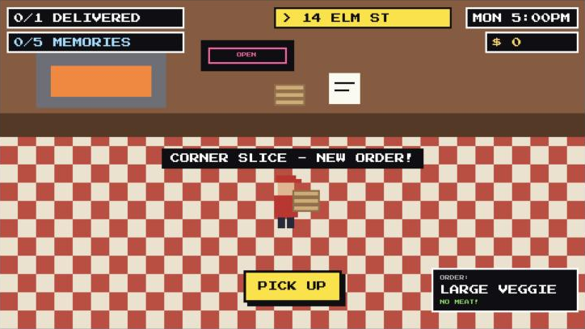
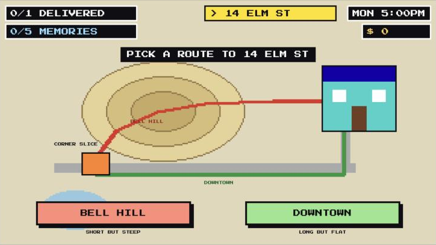
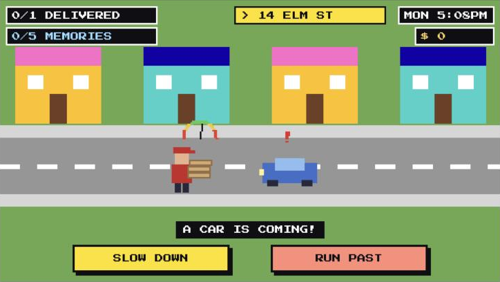
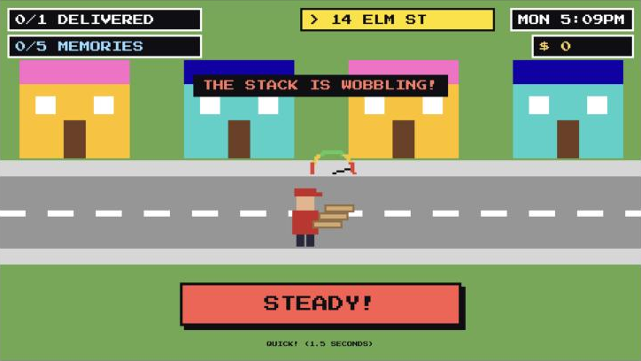
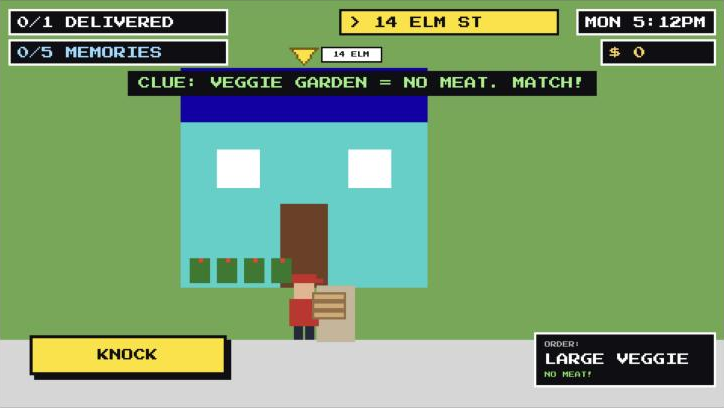
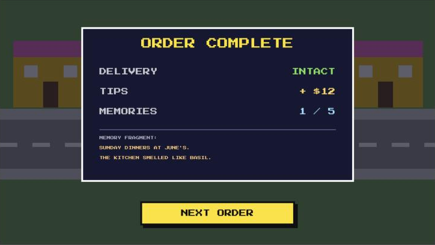
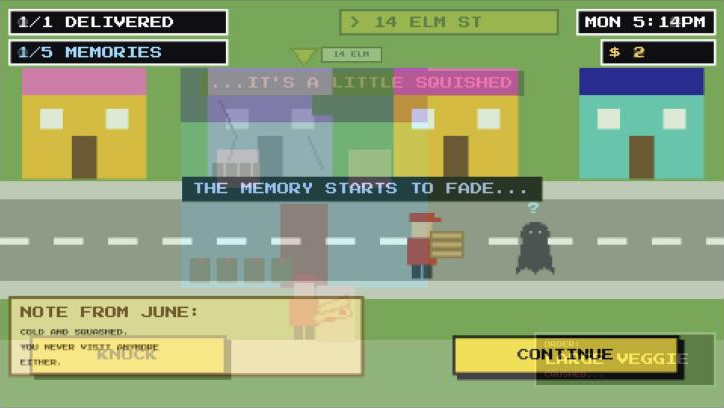

# Last Delivery

A top-down 2D pixel art pizza delivery game for CSS 385 at UW Bothell, by Yasin Maow and Shubh Malhotra.

You play a pizza delivery girl balancing a wobbly stack of boxes through the town of Bellrum over five night shifts. But Bellrum isn't real. It's her memory of the last five days before something bad happened, and every delivery decides which memories she keeps and which ones fade.

## Low-code prototype

**[Play the prototype in Figma](https://www.figma.com/proto/d73THswMk5yc7VDYS0WOgU/Last-Delivery-Low-Code-Prototype?node-id=2-3&starting-point-node-id=2%3A3)**

The prototype covers one full delivery on Monday:

1. Pick up the order at Corner Slice (a Large Veggie, no meat, for 14 Elm St).
2. Pick a route. Bell Hill is short but steep. Downtown is long but flat.
3. On Downtown, a car comes. Slow Down to stay safe, or Run Past and risk it.
4. When the stack wobbles, hit Steady within 1.5 seconds.
5. Knock on the door and read the note the resident leaves.
6. See the Order Complete screen with your tips and memories.

If the pizza arrives intact, June's house gets brighter, she leaves a warm note, and you unlock a good memory. If it gets crushed, her house fades, a shadow figure shows up, and the note is bitter.

### Screenshots

| | |
|---|---|
|  |  |
| Corner Slice: a new order comes in | Pick a route to 14 Elm St |
|  |  |
| Downtown: a car is coming | The stack is wobbling, hit Steady |
|  |  |
| Intact: the veggie garden clue matches | The memory gets stronger |
|  |  |
| Order complete: intact, +$12 | Crushed: "...it's a little squished" |
|  |  |
| The memory starts to fade | Order complete: crushed, +$2 |

## Docs

- [Game Design Document (PDF)](docs/Last_Delivery_GDD.pdf)

## What's next

- Build the core loop in Unity 2D: movement, pizza stack balancing and the tilt marker.
- Bellrum map blockout, deliveries, notes and the HUD.
- Houses that brighten or fade, and the five shifts from Monday to Friday.
